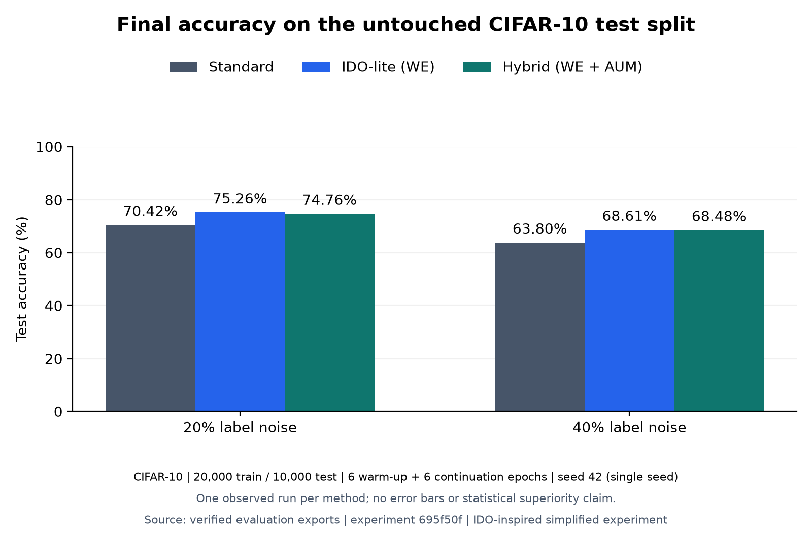
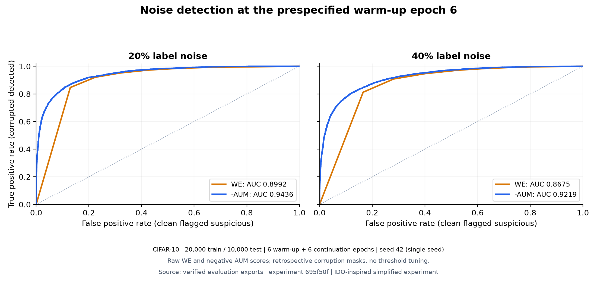
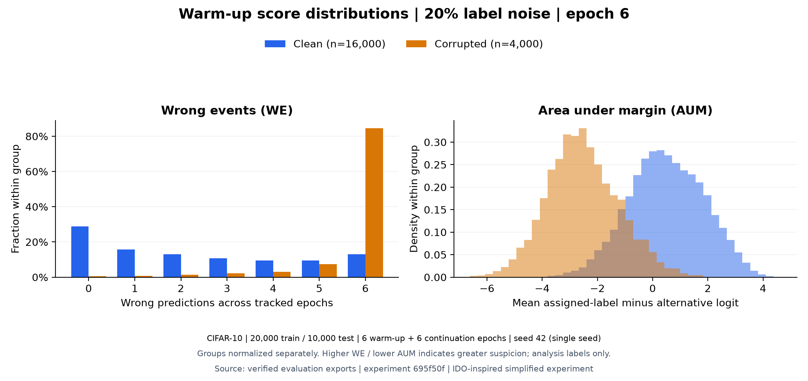
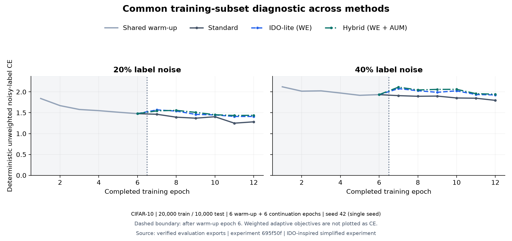

# IDO AUM Lite

Wrong events and area under margin for learning with noisy labels

Project implementation and experimental evaluation

Aditya Vilas
Sameet Vilas
Jay Manohar Kawade
Raghav Goenka
Pragati Garg
Saksham Mishra

BITS Pilani, K. K. Birla Goa Campus
BITS F471 - Introduction to Large Language Models
Group 2
November 2026

## Abstract

This study evaluates whether combining Wrong Events (WE) and Area Under the Margin (AUM) improves learning with noisy labels. The experiment uses 20,000 CIFAR-10 training images, exact 20% and 40% label flips, seed 42, and a shared 6-epoch warm-up followed by 6-epoch continuations. IDO-lite reaches 75.26% and 68.61% test accuracy, versus 70.42% and 63.80% for Standard cross-entropy. Hybrid reaches 74.76% and 68.48%. AUM detects corrupted labels more effectively than WE, but fixed 50:50 fusion does not improve classification over WE-only in this run. These are single-seed exploratory observations from an IDO-inspired simplified implementation, not a faithful reproduction or a statistically reliable superiority claim.

## 1 Motivation and relation to prior work

Wrong training labels and difficult correctly labelled images can both produce prediction disagreement. WE counts these events; a logit margin also records their direction and strength. The research questions are whether WE detects label corruption, how AUM compares, and whether a fixed blend improves final accuracy. This is a narrow multi-signal experiment, not an implementation of the earlier Group 2 proposal portfolio.

Original IDO uses Wrong Events, class-wise beta mixture estimation and dynamic instance-level optimisation [1]. AUM ranks samples by average assigned-label margin and includes threshold-sample calibration [2]. This implementation keeps cumulative WE and raw-logit AUM, replaces mixture estimation with within-provided-label-class ranks, simplifies the adaptive objective, and omits original base-model selection and AUM threshold calibration. The established signals are not claimed as new.

## 2 Data and fixed experimental design

The same 20,000 original training IDs are used for both conditions, stratified by original class (2,000 per class). The official 10,000-image test split remains untouched [3]. Exactly 4,000 or 8,000 distinct subset positions are flipped uniformly to one of the nine other classes; every selected label changes. Selection uses seed 42, with independent recorded SeedSequence streams for the two corruption masks. Clean originals and masks are stored separately for analysis, never as score, loss or selection inputs.

Table 1 Executed settings

| Item | Setting |
| --- | --- |
| Classifier | ResNet-18 from scratch; 3 by 3 stride-1 stem; no initial maxpool; 10 outputs [4] |
| Optimiser | AdamW [5]; lr 0.0003; weight decay 0.0001; batch 128 |
| Schedule | 6 shared warm-up + 6 continuation epochs per final model; 48 executed training epochs |
| Views | Crop 32x32 with padding 4 and horizontal flip; independent strong view adds jitter: brightness/contrast/saturation 0.2, hue 0.05 |
| Normalisation | Mean (0.4914, 0.4822, 0.4465); std (0.2470, 0.2435, 0.2616); deterministic statistics/test transforms |
| Execution | 2 workers; mixed precision enabled; constant learning rate; seed 42 |
| Evaluation | Fixed final checkpoints; entire clean test split; no test-set tuning |

Both adaptive branches share the same architecture, optimiser, augmentations, loss and refresh schedule; their intended difference is the suspicion score. Standard versus adaptive compares whole strategies. Numerical step skips are disclosed in Section 9.

## 3 Tracking and relative suspicion

After each completed epoch, one deterministic eval/no-grad pass visits every stable subset ID exactly once. With supplied label y-tilde and raw logits z, WE counts epochs predicted wrongly, not correct-to-incorrect transitions. The indicator I is one when its condition holds.

$$
WE_i(t)=\sum_{u=1}^{t}\mathbf{1}[\arg\max_k z_{i,k}(u)\ne\tilde y_i]
$$

$$
\delta_i(t)=z_{i,\tilde y_i}(t)-\max_{k\ne\tilde y_i}z_{i,k}(t)
$$

$$
AUM_i(t)=\frac{1}{t}\sum_{u=1}^{t}\delta_i(u)
$$

AUM averages margins over all completed observations, rather than using only the final margin. Within each provided-label class of size n, use one-based average ranks for ties. Rank larger WE and negative AUM as more suspicious. Empty classes are skipped; singleton or all-tied classes receive 0.5.

$$
s_{W,i}=(r_{WE,i}-0.5)/n,\qquad s_{A,i}=(r_{-AUM,i}-0.5)/n
$$

$$
s_i=s_{W,i}\ (WE\ only),\qquad s_i=(s_{W,i}+s_{A,i})/2\ (Hybrid)
$$

$$
c_i=0.1+0.9(1-s_i),\qquad d_i=4s_i(1-s_i)
$$

These are relative ranks, not corruption probabilities. Complete-class mean suspicion is 0.5 at both noise levels, imposing mean classification weight 0.55. The 0.1 floor and parabolic difficulty are experimental heuristics, not BMM estimates. Scores are frozen from prior completed epochs, then refreshed after the next full statistics pass. Standard continuation uses CE-only diagnostics without WE/AUM updates.

## 4 Shared adaptive objective

Weak and strong views produce probabilities p-w and p-s. A detached weak argmax gives pseudo-label q; mask m is one when detached weak confidence is at least 0.7. Both adaptive methods use the same weighted per-example terms:

$$
S_i=c_i CE(z_{w,i},\tilde y_i)
$$

$$
P_i=0.5s_i m_i CE(z_{s,i},q_i)
$$

$$
K_i=0.5d_i\frac{1}{10}\sum_{k=1}^{10}(p_{w,i,k}-p_{s,i,k})^2
$$

$$
L=\frac{1}{B}\sum_{i=1}^{B}(S_i+P_i+K_i)
$$

All terms use the full-batch denominator, including masked examples and partial final batches. Pseudo targets and scores are detached; consistency differentiates both views. CE and softmax use float32 under autocast. Sample-weighted epoch means must sum to total. The classification floor prevents zero weights, not necessarily zero gradients.

## 5 Fair branching and recovery

Each continuation restores the complete shared warm-up state, including BatchNorm buffers, then resets AdamW, scaler, branch RNG streams and controlled loader generators. Adaptive statistics are independent copies. Epoch checkpoints preserve model/optimizer/scaler, statistics, warm-up history, logs, Python/NumPy/CPU/CUDA RNGs, loader generators and code/configuration/data identities. Verified publication retains a prior generation. Resume restores state after object construction and before the next batch; cross-device bitwise equality is not assumed.

## 6 Classification results

All six fixed final models were evaluated once on the untouched 10,000-image test split. Each has 12 training epochs in its history, while warm-up computation is shared once per noise level. Gains below are percentage points, not relative percentage improvements.

Table 2 Final test accuracy

| Noise | Method | Accuracy percent | Gain vs Standard pp |
| --- | --- | --- | --- |
| 20% | Standard | 70.42 | +0.00 |
| 20% | IDO-lite | 75.26 | +4.84 |
| 20% | Hybrid | 74.76 | +4.34 |
| 40% | Standard | 63.80 | +0.00 |
| 40% | IDO-lite | 68.61 | +4.81 |
| 40% | Hybrid | 68.48 | +4.68 |

Figure 1 Measured final accuracy. Each bar is one seed; no across-seed uncertainty interval has been estimated.

IDO-lite exceeds Standard by 4.84/4.81 points at 20%/40% noise. Hybrid exceeds Standard by 4.34/4.68 points, but finishes 0.50/0.13 points below IDO-lite. The proposed fixed fusion is therefore not supported by this observed classification outcome. The Standard comparison includes changed loss and augmentation, so it does not isolate scoring.

## 7 Detection results and score distributions

The primary detector result uses shared warm-up epoch 6, with corrupted examples as positive. Earlier epochs are retrospective diagnostics, never selected by quality. Detector values repeat across continuation rows because their source warm-up is shared.

Table 3 Primary detection ROC AUC

| Noise | WE | Negative AUM | Hybrid ranks |
| --- | --- | --- | --- |
| 20% | 0.899201 | 0.943642 | 0.943767 |
| 40% | 0.867467 | 0.921886 | 0.919509 |

Figure 2 Raw WE versus negative-AUM ROC curves at the prespecified primary epoch. No learned cutoff or test-set tuning is applied.

Figure 3 Prespecified 20% noise condition. Groups are normalized separately; clean/corrupted labels are retrospective analysis only.

AUM AUC is 0.9436/0.9219, above WE at 0.8992/0.8675. Warm-up WE has only 7 possible counts, whereas margins distinguish many ties. Hybrid AUC is just above AUM at 20% and below it at 40%. Score distributions overlap; neither detector produces a perfect partition or guarantees improved training weights.

## 8 Learning dynamics and loss diagnostics

Figure 4 Common deterministic unweighted noisy-label CE. The boundary follows epoch 6; weighted adaptive objectives are not presented as CE.

The shared warm-up is followed by independently reset continuations. Standard attains lower common noisy-label CE but lower test accuracy. Fitting the supplied labels better is not necessarily better generalisation when some supplied labels are wrong.

Table 4 Sample weighted continuation averages

| Noise | Method | Confident percent | Supervised | Pseudo | Consistency | Total |
| --- | --- | --- | --- | --- | --- | --- |
| 20% | IDO-lite | 62.99 | 0.4400 | 0.0338 | 0.0023 | 0.4761 |
| 20% | Hybrid | 63.42 | 0.4251 | 0.0338 | 0.0024 | 0.4613 |
| 40% | IDO-lite | 34.37 | 0.7561 | 0.0218 | 0.0017 | 0.7796 |
| 40% | Hybrid | 36.31 | 0.7371 | 0.0227 | 0.0018 | 0.7617 |

Component columns include their weights. Confidence coverage is about 63% at 20% noise and 34-36% at 40%; pseudo-label supervision is active but often masked. Exact-zero pseudo terms are approximately 37%/37% and 66%/64% for WE-only/Hybrid at the two noise levels. Weighted supervised and total terms have no zero or near-zero examples at epsilon 1e-8. Consistency near-zero fractions span 0.00083-0.36417%. Mean c is about 0.55 and mean d spans 0.6801-0.6907. These are loss values, not gradient norms; coefficients do not equalise gradient influence.

## 9 Runtime and numerical behaviour

The saved environment records Tesla T4, Python 3.13.16, torch 2.14.1+cu130, torchvision 0.29.1+cu130, CUDA 13.0. Unique saved training/inference and publication times sum to 1351.31 seconds (22.52 minutes), counting warm-up once per condition. This excludes setup/process and other untimed overhead, not a complete GPU-use audit. No fallback or threshold amendment was used. Work totals 48 training epochs, 72 image-view passes, 36 statistics passes, 12 CE-only passes and six final test passes.

GradScaler recorded 3 skipped optimizer updates: one in each Standard continuation and one in 40% Hybrid; none in warm-ups or WE-only. No extra epochs compensated for skips. Configured schedules match, but realised update counts differ slightly, which matters when interpreting small accuracy gaps.

## 10 Interpretation and limitations

A stronger standalone detector need not create a better training weight. Both scores come from the same classifier and can share errors; class ranks discard absolute scale, and averaging can change the ordering used by all three loss roles. These are plausible explanations, not tested causal mechanisms. Supervised loss dominates the measured objective; no coefficient sweep was performed to seek a favourable result.

This is one seed, one architecture, 20,000 images, 12-epoch model histories and synthetic symmetric noise only. There is no across-seed variance estimate, significance test, hard-clean retention measurement, AUM-only training branch, real/asymmetric/instance-dependent noise evaluation or original-IDO reproduction. Coarse WE, rank-imposed mean suspicion, pseudo-label errors and the AMP skips limit inference. Passing implementation checks does not establish statistical reliability.

## 11 Reproducibility and development

The repository is github.com/Avilas01/ido-aum-lite. Training/evaluation used pinned commit 695f50f; the full configuration fingerprint is retained in results/experiment_config.json and the evaluation/plot manifests. Colab replication follows setup, hosted checks, benchmark, one frozen configuration, both noise conditions with --resume, and src.evaluate. Exact commands and the six-step recovery checklist are in README.md. Drive run-001 holds full checkpoints; results/ holds measured statistics and plots. The official archive is shared across sessions and extracted locally [6].

The current implementation was developed with Codex assistance in VS Code on Windows. Work completed includes deterministic corruption, stable-ID tracking, shared losses, epoch recovery, notebook orchestration, cached evaluation and verified plots. The local lightweight suite passed 209 tests with six PyTorch-dependent modules skipped locally. A hosted-test command, integrated GPU smoke and completed-stage resume were observed successful; fresh-VM recovery of an interrupted real epoch was not demonstrated. No local torch/CUDA installation, CIFAR download or model training was used.

## 12 Conclusion and future work

Both adaptive methods exceed Standard in this run; the fixed hybrid does not exceed WE-only accuracy. AUM nevertheless gives stronger warm-up detection. Next steps are independent seeds, original-IDO and AUM-only ablations, structured/real noise and preregistered confidence/loss studies. These are future experiments, not completed evidence.

## References

[1] K. Zhang et al. Handling Label Noise via Instance-Level Difficulty Modeling and Dynamic Optimization. NeurIPS 38, 2025. [Source](https://proceedings.neurips.cc/paper_files/paper/2025/hash/429e7b31625a8b7839f9e4d6e2aa9bb9-Abstract-Conference.html).

[2] G. Pleiss, T. Zhang, E. Elenberg and K. Q. Weinberger. Identifying Mislabeled Data using the Area Under the Margin Ranking. NeurIPS 33, 2020. [Source](https://proceedings.neurips.cc/paper_files/paper/2020/hash/c6102b3727b2a7d8b1bb6981147081ef-Abstract.html).

[3] A. Krizhevsky. Learning Multiple Layers of Features from Tiny Images. University of Toronto technical report, 2009. [Source](https://www.cs.toronto.edu/~kriz/cifar.html).

[4] K. He, X. Zhang, S. Ren and J. Sun. Deep Residual Learning for Image Recognition. CVPR, 2016. [Source](https://arxiv.org/abs/1512.03385).

[5] I. Loshchilov and F. Hutter. Decoupled Weight Decay Regularization. ICLR, 2019. [Source](https://arxiv.org/abs/1711.05101).

[6] Google. Colaboratory Frequently Asked Questions. Accessed November 2026. [Source](https://research.google.com/colaboratory/faq.html).
